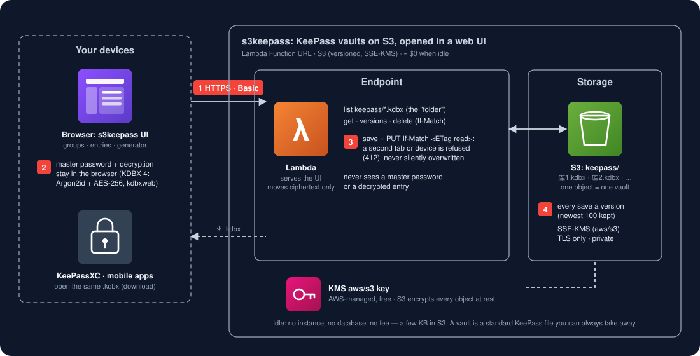

# s3keepass —— 放在 S3 上、用网页打开的 KeePass 密码库

> 自己掌握的密码管理器：每个库就是一个标准 **KeePass 文件（`.kdbx`）**，放在**你自己的 S3 桶**里，用 Lambda
> Function URL 提供的**网页**打开。解密只在你的浏览器里发生，服务器只搬运密文。空闲 ≈ $0，KeePassXC 照样能打开同一个文件。

[English](README.md) · [兼容性报告](tests/compat/REPORT.md) · [任务](tests/compat/TASKS.md) · [更新日志](CHANGELOG.md)



## 换过来是什么样

| | 以前 | s3keepass |
|---|---|---|
| 打开密码库 | 启动 KeePassXC，找到文件（Dropbox / iCloud / U 盘） | 打开一个网址，任何浏览器 |
| 文件放在哪 | 同步盘，或厂商的云（1Password、Bitwarden、LastPass） | 你的 S3 桶：`keepass/<库名>.kdbx`，想建几个建几个 |
| 文件格式 | `.kdbx`（KeePass）/ 私有格式（托管类） | `.kdbx` KDBX 4 —— KeePassXC 和手机 KeePass 应用直接打开 |
| 谁能解密 | 你（KeePass）/ 你，经由厂商客户端 | 你：主密码从不离开浏览器 |
| 两台设备同时保存 | 同步冲突副本（`…（冲突副本）.kdbx`） | 第二次保存被拒（S3 `If-Match`），不会被覆盖 |
| 历史 | 看同步服务留多少 | 每次保存都是一个 S3 版本，网页里可以恢复 |
| 费用 | $0 + 同步服务 / 每人每月 $3–8 | 空闲 ≈ $0（Lambda + S3 请求，存几 KB） |

网页用起来像 KeePassXC 的窗口：库列表像一个文件夹 → 输主密码解锁 → 左边分组树、中间条目、右边条目详情。复制用户名 /
密码（剪贴板 30 秒后清空）、显示、增删改条目和分组（删除进回收站）、密码生成器、改主密钥（主密码 + 可选密钥文件）、新建库、上传已有 `.kdbx`、
下载、锁定（空闲 5 分钟也会自动锁）。快捷键：⌘F 搜索、⌘B 复制用户名、⌘C 复制密码、⌘L 锁定、↑/↓、回车、Del。

## 原理

一个 Lambda 挂在 Function URL 后面，提供页面（`index.html`，无构建、无外部请求）和一个只管一个 S3 前缀的小 API：
列出 `keepass/*.kdbx`、取文件、**只有在仍是你打开的那个版本时才保存**（`PUT` 带 `If-Match: <ETag>`；新库用
`If-None-Match: *`）、列出和取旧版本、删除。浏览器用 **kdbxweb**（KeeWeb 的 KDBX 库）和 **argon2-browser**
（Argon2 参考实现编成 WASM）加解密，两者都内置并锁定版本，见 [src/server/vendor/](src/server/vendor/README.md)——
没有手写的加密代码。新库是 KDBX 4、AES-256、Argon2id 64 MiB × 8。主密钥和 KeePass 一样是主密码加可选的**密钥文件**：
KeePassXC 的 `.keyx` / `.key`、网页生成的，或任意文件——每次解锁在浏览器里选，从不上传。

桶是私有的、只允许 TLS、开了版本（每个库保留最新 `keep_versions` 个旧版本），静态加密用 SSE-KMS（AWS 托管的
`aws/s3` 密钥）。网页前面是 HTTP Basic（用户名 / 密码来自变量文件），每个库再各自要主密码。

## 快速开始

### 1. 部署一次

```bash
cp terraform/example.json terraform/real-s3keepass.json     # 改 aws_profile、console_auth_username、console_auth_password
terraform -chdir=terraform init
terraform -chdir=terraform apply -var-file=real-s3keepass.json
terraform -chdir=terraform output                      # console_url、bucket
```

`terraform -chdir=terraform destroy -var-file=real-s3keepass.json` 会拆掉全部资源，但桶里还有库时会停下，除非设了
`"force_destroy": true`——先把要留的库下载下来。

### 2. 打开网址

打开 `console_url`，用 `console_auth_username` / `console_auth_password` 登录，新建一个库（或上传 KeePassXC 的 `.kdbx`），把页面加书签。换新设备：
同一个网址，什么都不用装。离线或没有网址时：下载 `.kdbx`，用 KeePassXC 打开。

## 兼容性

[tests/compat/REPORT.md](tests/compat/REPORT.md) 每次跑测试自动生成。参照是 **Docker 里 KeePassXC 的
`keepassxc-cli`**：s3keepass 写的每个库文件都必须能被 keepassxc-cli 打开且分组、条目一致；keepassxc-cli 写的每个文件
也必须能在 s3keepass 打开。s3keepass 这一侧跑的是网页自己的加密代码（`index.html` 里的 `vault-core` 块和内置库），
在 Node 里无界面运行；每个文件两边各读一遍，结果必须相同。

| 状态 | 含义 |
|---|---|
| ✅ verified | 与 KeePassXC 一致，可放心依赖 |
| ❌ gap | 已知差异，备注指向 [TASKS.md](tests/compat/TASKS.md) 里修它的任务 |
| ⚪ quirk | 有记录、故意保留的差异 |
| ⛔ unsupported | 干净地拒绝——绝不半打开 |

```bash
python3 -m pytest tests -q                 # 不碰 Docker：keepassxc 容器在跑就实时比对，否则这些测试跳过
python3 -m pytest tests -q --docker up     # 构建/启动容器，等健康后测试；测完保持运行
python3 -m pytest tests -q --docker run    # 同上，全部通过就关掉；有失败就保持运行并提示
python3 -m pytest tests -q --docker down   # 同上，不管结果一律关掉
```

## 保证

| | 靠什么 |
|---|---|
| **机密性** | 主密码和解密后的条目只存在于浏览器标签页里；Lambda 和 S3 只见到 KDBX 密文（S3 再加一层 SSE-KMS）。严格的 Content-Security-Policy 只允许本页自己的脚本运行，库里的文字永远不会被当成代码执行。由 `test_server.py` 和 `tests/compat/` 固定 |
| **不丢更新** | 保存是 `PUT If-Match <本标签页打开时的 ETag>`；别的标签页或设备先存了，这次保存被拒（412），网页提示并提供下载你这份；不带条件的保存直接拒绝（428）。`test_stale_save_is_refused_never_overwritten` |
| **持久性** | S3 存好才返回（11 个 9）；每次保存都是新版本，存坏了或删错了，在“版本”对话框里恢复 |
| **可携带** | 库就是标准 KDBX 4 文件，下载下来 KeePassXC 就能打开（`tests/compat/`） |
| **可用性** | Lambda 和 S3 是区域级、天然多 AZ 的服务：没有实例会挂，没有维护窗口 |

## 适合谁

想要 KeePass 那套（自己的文件、自己的密码、不靠厂商）、又不想随身带文件、已经有 AWS 账号的个人或家庭。不适合：
需要共享、按人授权或审计的团队（用团队密码管理器）、硬件密钥解锁（YubiKey 挑战-响应）、浏览器自动填充（0.1.0
是复制到剪贴板）。要走就是下载一个文件：见 [MIGRATION.md](MIGRATION.md)。

## 目录

```
src/server/       服务本体：lambda_function.py（库 API）、index.html（网页）、vendor/（kdbxweb、argon2）
client/           pip 包 s3keepass（0.1.0 只有版本号；命令行在 0.2.0）
terraform/        部署：S3 桶、Lambda + Function URL、IAM
tests/            回归测试（假 S3）；tests/compat/ 对比 KeePassXC、REPORT.md、TASKS.md
```

## 发版

CI 每次 push 跑全部测试（带 keepassxc 容器）。发版就是打 tag：改 `client/pyproject.toml` 和
`client/s3keepass/__init__.py` 的版本号，写 CHANGELOG，提交，然后 `git tag vX.Y.Z && git push --tags`
（测试 → 构建 → PyPI；tag 必须等于版本号）。

---

**[Redefine AWS Serverless](https://github.com/topics/redefine-aws-serverless)** 系列之一——把空闲也计费的 AWS 服务，
用空闲 ≈ $0 的原语重做一遍。MIT。
