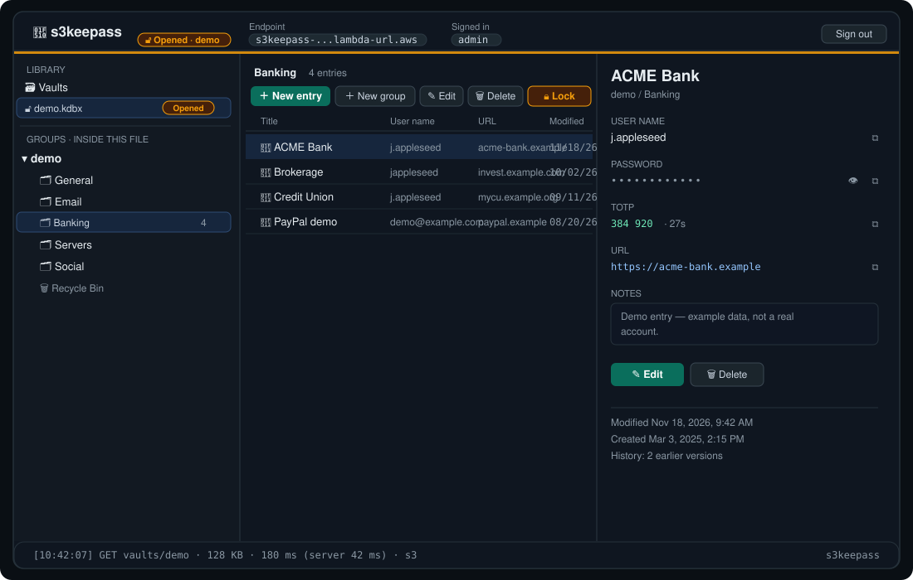
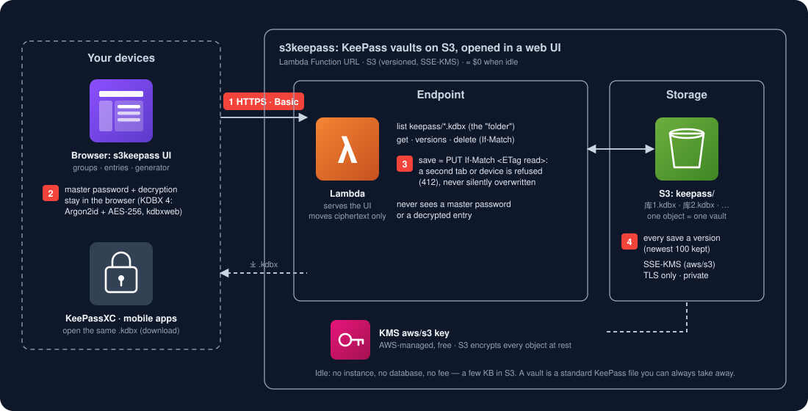

# s3keepass

**KeePass vaults (`.kdbx`) on your own S3, opened in a web UI served by a Lambda Function URL — decrypted only in
your browser, ≈ $0 when idle, and KeePassXC still opens the same file.** Part of
[IdleFree](https://cloudformer.github.io/).

0.1.0 is the service: deploy it once from the [main repository](https://github.com/cloudformer/s3keepass#quick-start)
(Terraform) and open the URL. This package holds the version only; the command line
(`pip install s3keepass`, then `s3keepass entry get github` …) comes in 0.2.0.

Compatibility with KeePassXC: [REPORT.md](https://github.com/cloudformer/s3keepass/blob/main/tests/compat/REPORT.md).

## Local KeePass apps

A `.kdbx` from s3keepass, downloaded and opened in a KeePass app: which versions work. Shown as a table at
[cloudformer.github.io/s3keepass/compat.html](https://cloudformer.github.io/s3keepass/compat.html), which reads it
from here.

<!-- compat:start -->
<!-- compat:en -->
### s3keepass kdbx compatibility for local apps

|  | Windows · KeePassXC | Windows · KeePass | Windows · KeePass + KeePassOTP plugin | Mac · KeePassXC | iPhone · KeePassium | Android · KeePassDX | Android · Keepass2Android |
|---|---|---|---|---|---|---|---|
| ✕ Does not open | < 2.6.3 | < 2.47 | < 2.47 | < 2.6.3 | < 1.21 | < 2.9.4 | < 1.08d |
| ! Opens, no 6-digit code | — | ≥ 2.47 | — | — | — | — | — |
| ✓ Works | ≥ 2.6.3 | — | ≥ 2.47 | ≥ 2.6.3 | ≥ 1.21 | ≥ 2.9.4 | ≥ 1.08d |
| Also: tested | 2.7.9 * | — | not tested | 2.7.9 * | not tested | not tested | not tested |

- ✕ does not open, cannot be used
- ! opens; user name, password, URL and notes all work; no 6-digit code
- ✓ everything works, the 6-digit code included

1. The first three rows are the result, versions from each app's release notes; the fourth adds what has really been tested. KeePass without the plugin never shows the code, so it has nothing to test there.
2. "Does not open" comes from Argon2id, the key derivation s3keepass vaults use, not from TOTP. KeePass 2.47, KeePassXC 2.6.3 and KeePassium 1.21 added it, all in early 2021.
3. TOTP is the `otp` attribute holding an `otpauth://` URI, which most apps read. KeePass reads only its own `TimeOtp-*` fields, hence the plugin.
4. Editing and saving in a "!" app keeps the `otp` attribute; s3keepass still shows the code afterwards. No app refuses a file because of it.
5. \* Tested with `keepassxc-cli` 2.7.9 (Linux, Docker; tests/compat 20/20): the same core as the desktop app, not clicked through its window.
6. Strongbox is not listed: no release note says from which version it opens Argon2id.

Sources: [KeePassXC 2.6.3](https://www.linuxtoday.com/news/keepassxc-2-6-3-password-manager-adds-support-for-argon2id-kdf-and-xmlv2-key-files) · [KeePassium 1.21](https://keepassium.com/blog/2021/02/keepassium-1.21) · [KeePassDX 2.9.4](https://github.com/Kunzisoft/KeePassDX/blob/master/CHANGELOG) · [Keepass2Android 1.08d](https://www.apkmirror.com/?p=3033967) · [Keepass2Android TOTP](https://github.com/PhilippC/keepass2android/blob/master/docs/Generating-TOTPs.md) · [KDBX 4](https://keepass.info/help/kb/kdbx_4.html)

<!-- compat:zh -->
### s3keepass kdbx兼容性本地列表

|  | Windows · KeePassXC | Windows · KeePass 官方 | Windows · KeePass 官方 + KeePassOTP 插件 | Mac · KeePassXC | iPhone · KeePassium | Android · KeePassDX | Android · Keepass2Android |
|---|---|---|---|---|---|---|---|
| ✕ 不能用 | < 2.6.3 | < 2.47 | < 2.47 | < 2.6.3 | < 1.21 | < 2.9.4 | < 1.08d |
| ! 能打开，不显示 6 位码 | — | ≥ 2.47 | — | — | — | — | — |
| ✓ 正常 | ≥ 2.6.3 | — | ≥ 2.47 | ≥ 2.6.3 | ≥ 1.21 | ≥ 2.9.4 | ≥ 1.08d |
| 补充：实测通过 | 2.7.9 * | — | 未实测 | 2.7.9 * | 未实测 | 未实测 | 未实测 |

- ✕ 打不开，无法使用
- ! 能打开，用户名、密码、URL、备注都正常，不显示 6 位码
- ✓ 全部正常，包括 6 位码

1. 前三行是结论，版本号来自各家更新日志；第四行是补充，列出真的跑过测试的版本。没装插件的官方 KeePass 本来就不显示 6 位码，第四行写 —。
2. “不能用”是因为 s3keepass 库用的 Argon2id 加密算法，和 TOTP 无关。KeePass 官方 2.47、KeePassXC 2.6.3、KeePassium 1.21 开始支持它，都在 2021 年初。
3. TOTP 用的是 `otp` 字段 + `otpauth://` 链接，多数客户端都认。官方 KeePass 只认自己的 `TimeOtp-*` 字段，所以要装插件。
4. 在 “!” 的客户端里编辑、保存，`otp` 字段会保留，传回 s3keepass 照样能算码；任何客户端都不会因为这个字段报错。
5. \* 实测用的是 Docker 里的 Linux 命令行版 `keepassxc-cli` 2.7.9（tests/compat 20/20），和桌面版同一套核心代码，但不是在桌面版界面上点的。
6. Strongbox 查不到从哪个版本号开始支持 Argon2id，所以没列。

来源：[KeePassXC 2.6.3](https://www.linuxtoday.com/news/keepassxc-2-6-3-password-manager-adds-support-for-argon2id-kdf-and-xmlv2-key-files) · [KeePassium 1.21](https://keepassium.com/blog/2021/02/keepassium-1.21) · [KeePassDX 2.9.4](https://github.com/Kunzisoft/KeePassDX/blob/master/CHANGELOG) · [Keepass2Android 1.08d](https://www.apkmirror.com/?p=3033967) · [Keepass2Android TOTP](https://github.com/PhilippC/keepass2android/blob/master/docs/Generating-TOTPs.md) · [KDBX 4](https://keepass.info/help/kb/kdbx_4.html)
<!-- compat:end -->
